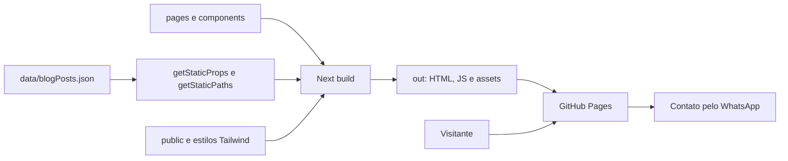
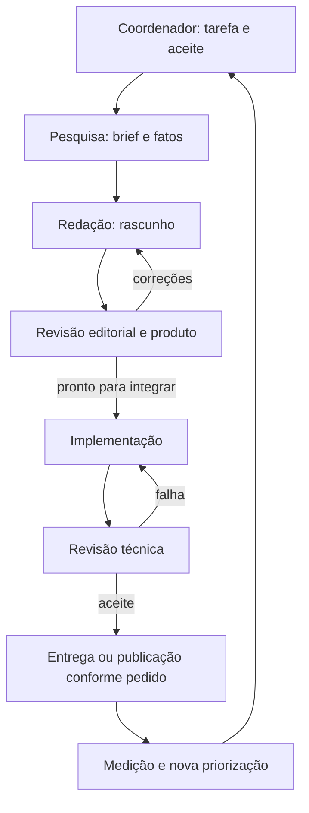

# Arquitetura de implementação e operação agêntica

## Arquitetura observada

Stack atualizada da origem: Next 14.0.3 Pages Router, React 18, TypeScript, Tailwind e lucide 0.526.0. Sem API/backend conectado, CMS ou banco de leads. Após T002 local, `/din_page` exporta default com copy/metadados no HTML inicial; query seleciona improvisation após hidratação. Não constitui um conjunto de variantes SEO pré-geradas por URL.

`pages/_app.tsx` monta `components/WhatsAppButton.tsx` globalmente. Home, footer, depoimentos e landings têm CTAs com mensagens pré-preenchidas. Blog possui três artigos; T002 liga localmente dois CTAs à landing default, terceiro mantém home. `data/contact.ts` centraliza WhatsApp para landing/footer/botão global; os demais consumidores ainda usam seus links existentes. Origem e último deploy identificado usam 78362aa; o workspace acrescenta T002 à variante local de Early Access, sem publicação.

## Arquitetura alvo incremental

Manter o export estático na primeira frente. Centralizar configuração de domínio/contato e o tipo editorial; validar dados antes do build; filtrar conteúdo publicado consistentemente; gerar metadados e sitemap a partir dos mesmos dados. O artigo deve poder receber texto em blocos, sumário, imagem, relacionados e CTA sem uma migração grande.

Manter drafts em `docs/site/editorial/rascunhos/` inicialmente. Só conteúdo revisado entra em `data/blogPosts.json` enquanto não existir filtro de status. Revisar a escolha JSON versus Markdown/MDX quando número de autores e complexidade de edição justificarem. Não reescrever a aplicação para permitir os primeiros artigos.

## Papéis e contratos dos agentes

| Papel | Entrada | Trabalho | Saída | Escopo de escrita e revisão |
| --- | --- | --- | --- | --- |
| Coordenador | Objetivo, decisões, backlog e estado do repo | Priorizar, abrir tarefa, resolver dependências e consolidar | Plano e tarefa com responsável, aceite e riscos | plans, tasks, decisões e progresso |
| Pesquisador de público/SEO | Público, dor e inventário de posts | Confirmar intenção, evitar sobreposição, pesquisar fatos | Brief e registro de fontes; marcar hipóteses | editorial e fontes; não inventar volume de busca |
| Redator | Brief, evidências e tom | Escrever resposta prática, exemplo e convite contextual | Rascunho e mapa de afirmações | rascunhos; não editar aplicação |
| Revisor editorial/produto | Rascunho, fatos e capacidades reais | Conferir utilidade, exatidão, oferta e prova | Texto revisado ou devolução pontual | Texto e checklist de revisão |
| Implementador | Texto revisado e contrato editorial | Integrar dados, CTA, assets e metadados; corrigir template | Diff de fonte e export validado | data, pages, components e assets atribuídos |
| Revisor técnico/QA | Diff e critérios de aceite | Verificar rotas, renderização, acessibilidade e build | Evidência de testes e falhas objetivas | evidence; correções retornam ao implementador |
| Analista de aquisição | Métricas disponíveis e registro comercial | Relacionar leituras, contatos e qualificação | Hipóteses e próximo experimento com critério | evidence/plans; sem disparos ou promessa de resultado |

O fundador/responsável de produto é a fonte para capacidade entregue, oferta e autorização de casos de clientes. Sua revisão é solicitada quando faltar esse fato ou quando o escopo da sessão exigir aprovação; não funciona como nova autorização obrigatória para toda edição.

## Fluxo de handoff

Cada handoff usa `templates/handoff.md`: identifica tarefa, arquivos, decisões, checagens e pendências. Revisor não declara uma capacidade comercial pelo simples fato de ela aparecer no texto anterior do site.

## Política de execução

Os papéis são funções com contratos e memória em arquivos, não processos permanentes. Nesta entrega o trabalho foi executado sequencialmente. Paralelismo, quando explicitamente solicitado, é adequado entre pesquisa e correções técnicas; redação depende do brief e integração depende da revisão. Atribuir dono único a `data/blogPosts.json` e não permitir edições simultâneas dos mesmos templates.

## Memória e rastreabilidade

`09-decisoes.md` guarda escolhas e motivos. `10-progresso.md` guarda estado real e próximo passo. `tasks` guarda execução verificável. `evidence` guarda resultados datados. `plans` guarda desenho por iniciativa. Código e dados de aplicação continuam sendo a verdade para o comportamento instalado; documentos de proposta não representam funcionalidades prontas.
